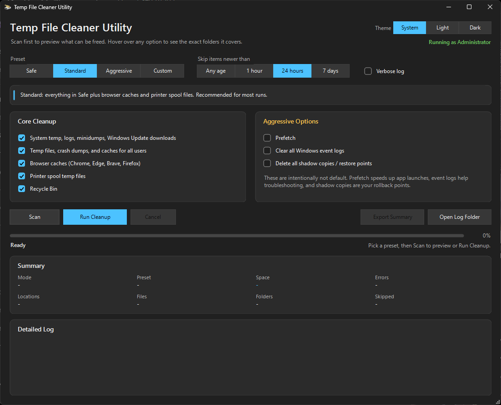
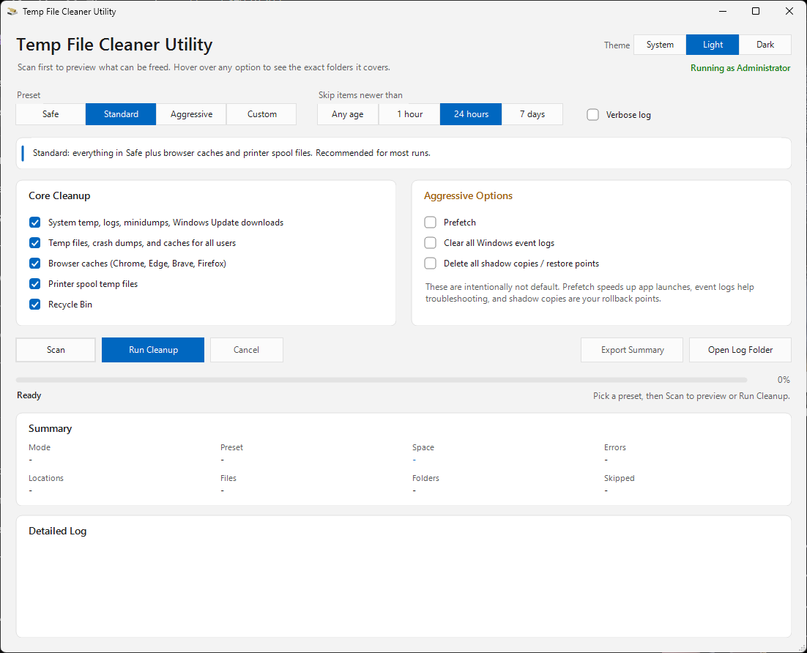

# Temp File Cleaner Utility

A modern Windows cleanup utility with a simple GUI, scan mode, and safe cleanup presets.

This tool is designed to be easy to use, transparent, and safe to share with others.

## What's New in v3.0

* Light and dark themes. The app follows your Windows app theme by default, or you can pick Light or Dark
* The window stays responsive during long runs, and **Cancel** (or Esc) stops a run
* New **Skip items newer than** filter (default 24 hours) leaves recent temp files alone, since installers and open apps may still be using them
* Reports space actually freed, not just space found
* Cleans everything it can inside a folder, even when one file in it is locked
* Never follows junctions or symbolic links out of a temp folder
* Browser caches now cover every Chrome, Edge, Brave and Firefox profile, and only the cache folders are cleaned
* Scan measures the Recycle Bin size
* Warns you before cleanup if a browser is still open
* Hover over any option to see exactly which folders it covers
* Remembers your theme, preset and options between runs

## Features

* Clean, simple GUI with light and dark themes
* Scan mode to preview results before deleting anything
* Multiple cleanup presets:

  * Safe
  * Standard
  * Aggressive
  * Custom
* Summary dashboard:

  * Files and folders found and deleted
  * Items skipped as recent, in use, or access denied
  * Space reclaimable (scan) or freed (cleanup)
* Color-coded detailed log
* Exportable summary reports

## Cleanup Presets

### Safe

* System temp files
* User temp files
* Recycle Bin

Best for routine cleanup with minimal risk.

### Standard

* Everything in Safe
* Browser caches
* Printer spool temp

Recommended default.

### Aggressive

Includes everything in Standard plus:

* Prefetch
* Windows Event Logs
* Shadow Copies / Restore Points

Use with caution:

* Event logs may be needed for troubleshooting
* Shadow copies can be valuable rollback points
* Apps may start slower until Windows rebuilds Prefetch

### Custom

Tick exactly the options you want. Changing any option switches the preset to Custom.

## Skip Items Newer Than

Files and folders created or changed within the chosen window are kept and counted as **recent**:

* **Any age**: delete everything that can be deleted
* **1 hour**
* **24 hours** (default)
* **7 days**

Installers often unpack files into temp folders and use them for the whole install, so leaving recent items alone avoids breaking anything that is running.

## Browser Caches

Only cache folders are cleaned. Bookmarks, passwords, history and cookies are never touched.

* Chrome, Edge and Brave: `Cache`, `Code Cache` and `GPUCache` in every profile
* Firefox: `cache2`, `startupCache` and `thumbnails` in every profile

Files a running browser is using are skipped, so close your browsers first for a full cleanup.

## How to Run

Requires Windows 10 or 11 and administrator rights.

### Batch launcher

1. Open the tool folder
2. Double-click `Run Temp File Cleaner Utility.bat`
3. Accept the administrator prompt if prompted

### Executable

1. Double-click `TempFileCleanerUtility.exe`
2. Accept the administrator prompt

The executable is the same script compiled with [PS2EXE](https://github.com/MScholtes/PS2EXE). Logs, summaries and `settings.json` are saved next to whichever one you run.

## Typical Workflow

1. Click **Scan**
2. Review the summary
3. Click **Run Cleanup**
4. Confirm your selection
5. Review the completion summary

## Light Theme

## Notes

* Some files may be locked by the system and cannot be removed
* Skipped or locked items are normal
* Some paths may not exist on every system
* Deleted files do not go to the Recycle Bin

## Credit

This utility was inspired by legacy cleanup concepts popularized by Hiren’s utility collection, but it is a separate modern PowerShell GUI implementation.

## Disclaimer

Use at your own risk. Review selections carefully before running cleanup, especially when using aggressive options.
